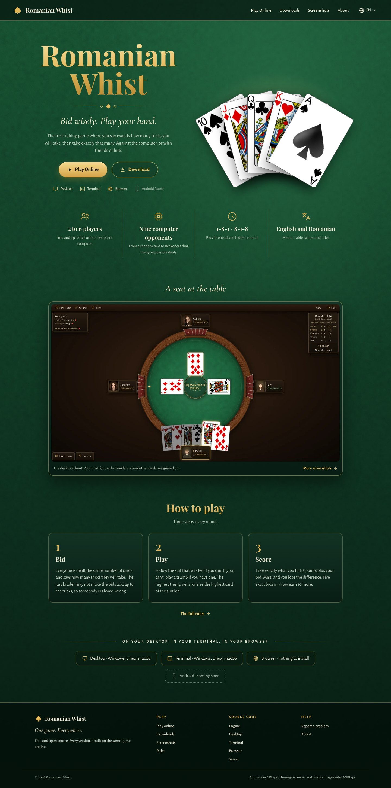

# Romanian Whist website

The website of [Romanian Whist](https://en.wikipedia.org/wiki/Romanian_whist), the trick-taking
card game where you say exactly how many tricks you will take, then take exactly that many. It
introduces the game and sends people to it: to play online, to download a client, to see it and to
learn the rules. It has four pages, Home, Downloads, Screenshots and About, in English and Romanian.

**Status:** planned. The design is approved and the plan is written; nothing is built yet.

- [`docs/site-plan.md`](docs/site-plan.md) is the plan: the technology, every page, and the phases
  that build it.
- [`docs/site-mockup/`](docs/site-mockup/README.md) is the design the site is built to, with a
  picture of every page in both languages.

It will be a static site, built with [Astro](https://astro.build/) and TypeScript, and hosted on
GitHub Pages. Building and running it are described here once phase 1 has set it up.

## The game

Each client is its own repository, and all of them are built on one engine:

| Repository | What it is |
|---|---|
| [`romanian_whist_engine`](https://github.com/conectionist/romanian_whist_engine) | The rules, the scoring and the computer opponents |
| [`romanian_whist_desktop`](https://github.com/conectionist/romanian_whist_desktop) | The desktop client, for Windows, Linux and macOS |
| [`romanian_whist_terminal`](https://github.com/conectionist/romanian_whist_terminal) | The terminal client |
| [`romanian_whist_server`](https://github.com/conectionist/romanian_whist_server) | The game server for online tables |
| [`romanian_whist_web`](https://github.com/conectionist/romanian_whist_web) | The browser client, played at <https://whist.akdscloud.eu> |
| [`romanian_whist_android`](https://github.com/conectionist/romanian_whist_android) | The Android app, planned |

## License

The website is licensed under the [GNU Affero General Public License v3.0](LICENSE).

The card art is [Vector Playing Cards](https://opengameart.org/content/playing-cards-vector-png)
by Byron Knoll, in the public domain. The fonts, Playfair Display, Cormorant Garamond and Alegreya
Sans, are under the SIL Open Font License.
